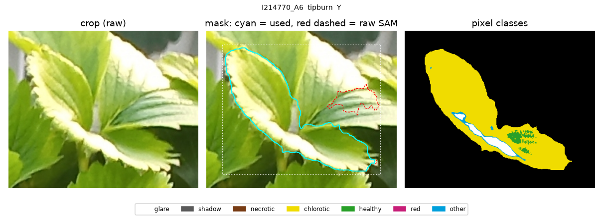
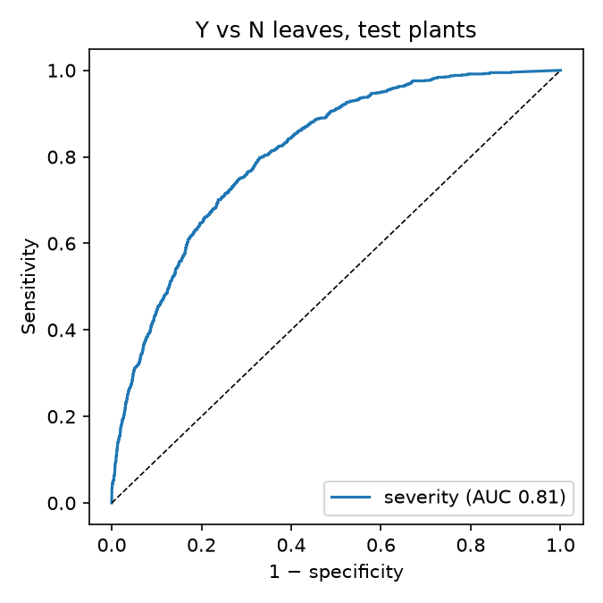
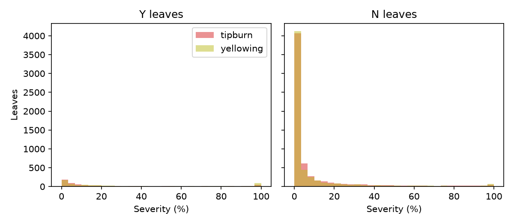
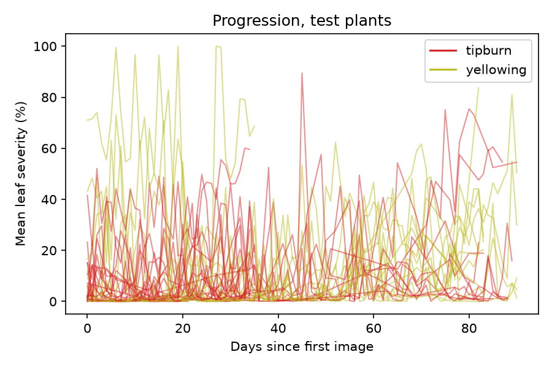
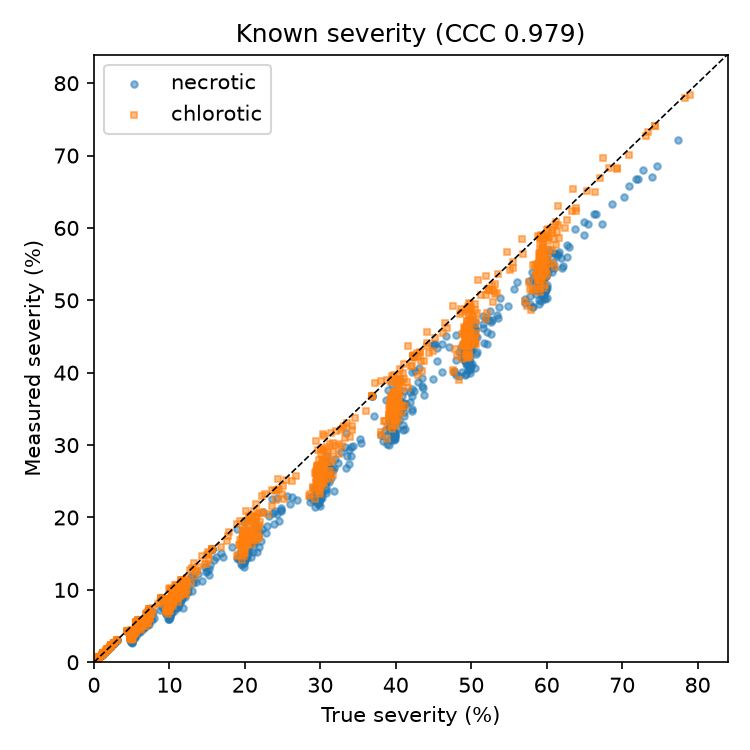

# Strawberry leaf stress under greenhouse lighting

Can colour identify symptomatic strawberry leaves, and does symptom location help distinguish tip burn from yellowing? This feasibility study uses CIELAB pixel classes and leaf-relative geometry to answer both questions in greenhouse images of Seolhyang strawberries.

[](figures/tipburn_mask_and_pixel_classes.png)

The cyan outline shows the mask used for analysis. The red dashed outline shows the raw SAM prediction. The right panel maps the colour classes inside the refined mask for one tip-burn-labelled leaf (I214770_A6). The map is the method's output.

## What the study found

| Question | Evaluation | Result |
| --- | --- | --- |
| Can colour detect symptomatic leaves? | 8,609 annotated leaves from 34 held-out plants | Zone-based severity ROC AUC **0.810** (95% CI 0.767–0.842), PR AUC **0.365**. Mean hue ROC AUC was **0.815**. |
| How did the score behave over time? | Mixed model on 34 held-out plants | Severity rose **0.270 percentage points per day faster** on Y-labelled leaves than on N-labelled leaves from the same plants (95% CI 0.220–0.319). Background hue also drifted during the season. |
| How well did it recover known lesion area? | 1,920 synthetic overlays on 40 N-labelled test leaves | Concordance correlation coefficient **0.979** with a mean bias of **−3.26 percentage points**. Overlay colours were selected from zones the method already recognised. |
| Did location improve tip burn vs. yellowing discrimination? | 1,461 Y-labelled leaves across 54 plants, repeated plant-grouped cross-validation | Leaf ROC AUC **0.607** for colour fractions and **0.590** for colour plus placement. The difference was **−0.017** (95% CI −0.063 to +0.020). |

At the calibration-selected **2.39%** severity threshold, test sensitivity was **0.806** and specificity was **0.651**. Only **11%** of the test annotations were Y. Detection ROC AUC was **0.842** in yellowing plants and **0.769** in tip-burn plants. In the audit of the 20 highest-scoring N-labelled leaves, 11 were undersides or backlit leaves and five showed visible symptoms despite the N label. This audit represents the highest-scoring disagreements.

## Results figures

### Symptom detection on held-out plants

[](figures/roc_detection.png)

The CIELAB severity score achieved a ROC AUC of **0.81** across 34 held-out plants.

### Severity distributions by symptom label

[](figures/severity_histograms.png)

The two panels show counts. N-labelled leaves are much more common than Y-labelled leaves.

### Severity over time

[](figures/progression_test_plants.png)

Each trace shows a test plant. The mixed model estimated a **0.27 percentage-point-per-day** faster rise on Y-labelled leaves than on N-labelled leaves from the same plants.

### Agreement on synthetic lesions

[](figures/synthetic_severity_agreement.png)

Estimated and known synthetic lesion coverage had a concordance correlation coefficient of **0.979**.

## Data and workflow

- **Dataset.** [AI Hub 305](https://www.aihub.or.kr/aihubdata/data/view.do?dataSetSn=305), one Seolhyang farm (AI22_003), 56 plants, 2,968 images and 13,618 retained leaf boxes. The study kept one image per plant per day, selected closest to noon. Y and N are the dataset's leaf-level symptom annotations. Tip burn and yellowing are symptom categories produced by several treatments.
- **Leaf mask.** The study prompted a pretrained SAM ViT-B with each annotated box, with GrabCut available as a fallback. Mask refinement filled holes, selected the leaf that best matched the box and trimmed thin protrusions.
- **Colour scoring.** RGB pixels were converted to CIELAB. The selected setup used raw RGB, the broad glare exclusion, hue boundaries of 70° and 120°, and 1% mask erosion. Severity was the percentage of evaluated leaf pixels classed as chlorotic or necrotic. Glare and qualifying shadows were excluded from the denominator.
- **Plant-level evaluation.** Detection used 22 plants for calibration and 34 for testing. The separate comparison of symptom categories used repeated five-fold cross-validation grouped by plant, with class-balanced logistic regression. Placement features used leaf-relative margin, tip, vein and connected-patch measurements.

## Scope and limitations

The original analysis covers one farm and one cultivar. Camera angle, backlighting, seasonal colour drift and incomplete annotations can affect the score. Some pale leaves can score near 100% when most pixels cross the 120° hue boundary. Real lesion area still needs validation against expert pixel masks. The method measures visible symptoms, and the treatment groups contain overlapping appearances.

## Reproduce the analysis

Install the Python dependencies. For the SAM run, also install PyTorch and Segment Anything and download the [ViT-B checkpoint](https://github.com/facebookresearch/segment-anything#model-checkpoints). The dataset archives are available through AI Hub.

```bash
python -m pip install -r requirements.txt
python -m pip install torch "git+https://github.com/facebookresearch/segment-anything.git"

python make_leaf_table.py --root "path/to/Training" --root "path/to/Validation" --out leaves.csv

python run_305.py segment --leaf-table leaves.csv --cache cache --out reproduction --sam-checkpoint sam_vit_b_01ec64.pth
python run_305.py calibrate --leaf-table leaves.csv --cache cache --out reproduction --workers 4
python run_305.py features --leaf-table leaves.csv --cache cache --out reproduction --workers 4
python run_305.py analyse --leaf-table leaves.csv --cache cache --out reproduction --n-boot 1000
python known_severity.py --leaf-table leaves.csv --cache cache --out reproduction --n-leaves 40
```

Use the AI Hub release for farm AI22_003. The preparation script reads annotated leaf boxes and extracts the retained images from the source archives. Use a separate output folder for reruns so the original result exports remain available for comparison. The versioned [frozen config](results/frozen_config.json) records the 150-setting calibration and plant split seed. The [synthetic smoke-test generator](make_synthetic_test_data.py) can exercise the pipeline without AI Hub data or SAM weights.

Use `python -X utf8` in place of `python` if your terminal uses a legacy text encoding.

```bash
python make_synthetic_test_data.py --out synth
python run_305.py all --leaf-table synth/leaves.csv --cache synth/cache --out synth/results --n-boot 200 --n-repeats 3
```

## Repository contents

- [Figures](figures/README.md) includes the original mask panel, ROC, severity histograms, test-plant progression and synthetic agreement.
- [Results](results/README.md) links the calibration, detection, progression, discrimination and synthetic-lesion outputs.
- [Pipeline](run_305.py) runs segmentation, calibration, feature extraction and evaluation.
- [LinkedIn draft](LINKEDIN.md) contains the post and suggested carousel order.

Study by Isabel Aziz-Hendrick. The methodology builds on [da Silva et al. (2022)](https://doi.org/10.1016/j.compag.2021.106542) and uses [Segment Anything](https://github.com/facebookresearch/segment-anything) for the original leaf segmentation.
